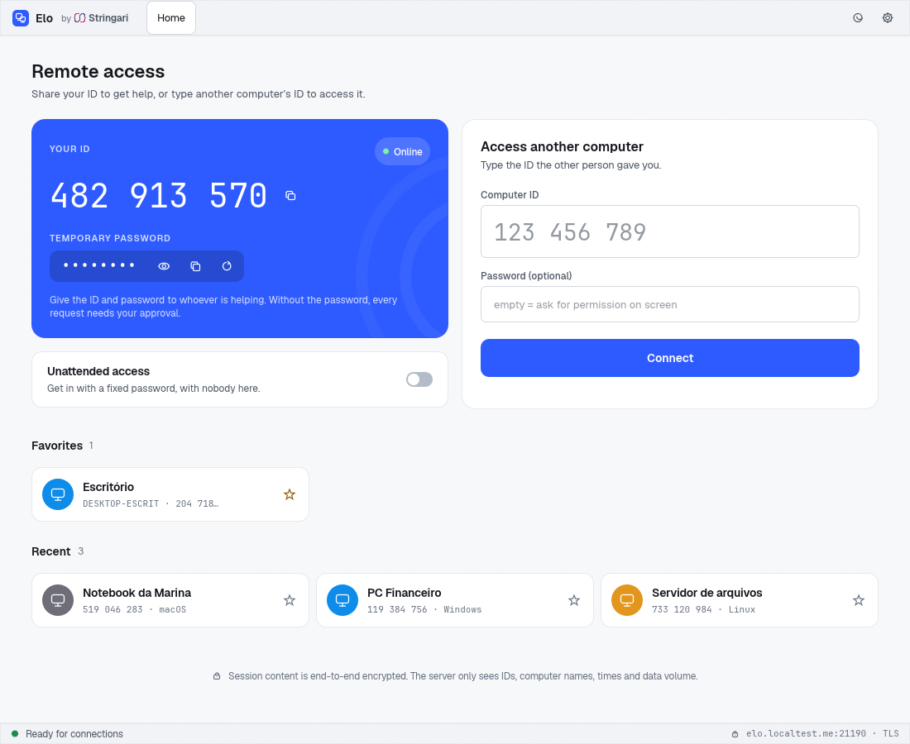
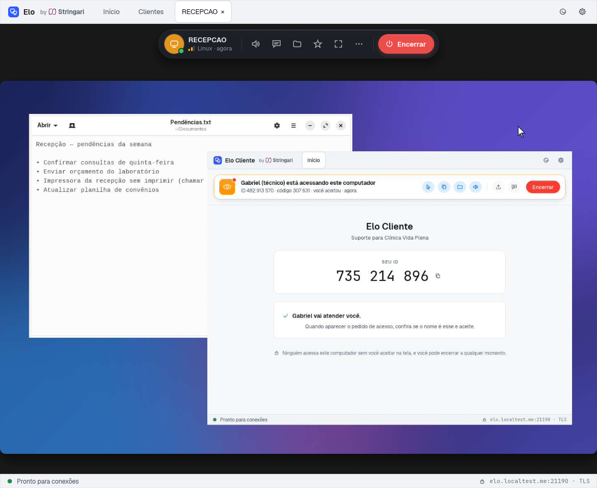
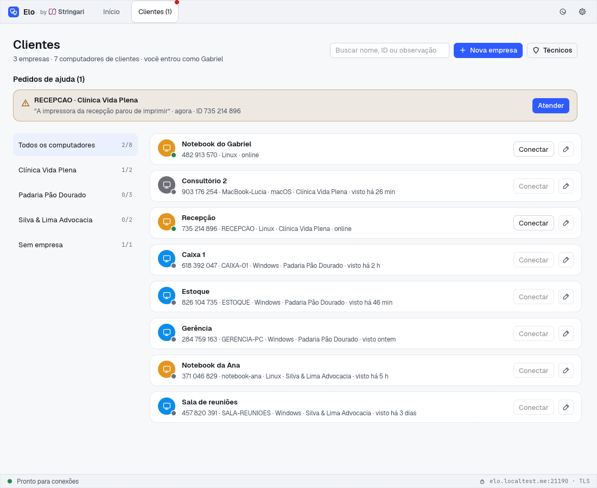

<p align="center">
  
</p>

<h1 align="center">Elo Remote Desktop</h1>

<p align="center">
  <strong>Open-source remote desktop and remote support, end-to-end encrypted, with your own server.</strong><br>
  A free, self-hosted alternative to TeamViewer and AnyDesk for Linux, Windows and macOS. Written in Rust.<br>
  No account, no mandatory cloud.
</p>

<p align="center">
  <a href="https://github.com/Stringari-Consultoria/elo/releases/latest"></a>
  <a href="https://github.com/Stringari-Consultoria/elo/actions/workflows/ci.yml"></a>
  <a href="#license"></a>
  
  
</p>

<p align="center">
  <b>English</b> · <a href="README.pt-BR.md">Português (Brasil)</a>
</p>

<p align="center">
  <picture>
    <source media="(prefers-color-scheme: dark)" srcset="docs/prints/en/02-home-dark.png">
    
  </picture>
</p>

---

Elo lets one computer see and control another computer's screen, with chat,
clipboard sync, file transfer and remote audio. It does the same job as
TeamViewer and AnyDesk, with two differences. **The server is yours**: it is
built into the app, or you host your own (Linux, Docker, Windows, macOS). And
**nobody in the middle can read the session**, not even the server.

It is made for **remote support**: IT teams, managed service providers (MSPs)
and anyone who helps family and friends. Support companies get client
organizations, technician accounts, a "Ask for help" button and unattended
access.

> **Project status: alpha.** Tested on real machines on Linux (X11) and macOS,
> GNOME Wayland in an isolated test session, and end-to-end tests in CI.
> Windows builds and passes the CI tests but has not been tested on a real
> machine yet. Read the
> [known limitations](#known-limitations) before using it in production.

## Contents

- [Features](#features)
- [Download and install](#download-and-install)
- [How to use](#how-to-use)
- [Self-hosted server](#self-hosted-server)
- [Support companies and Elo Cliente](#support-companies-and-elo-cliente)
- [Security](#security)
- [FAQ](#faq)
- [How it works](#how-it-works)
- [Development](#development)
- [Known limitations](#known-limitations)
- [License](#license)

## Features

- **Remote control** of mouse and keyboard, with **multiple monitors**: switch
  between screens, or open **one window per screen** (put each one on its own
  desktop or monitor).
- **Remote audio**: what plays there comes out here (Opus, 96 kbps), with volume control.
- **Chat and clipboard** in both directions.
- **File manager**: browse the other computer's folders, download and upload
  files (or drag them onto the session window).
- **Screenshots** of the remote screen (full screen or a selected area), saved and copied.
- **Open the remote terminal** (Command Prompt on Windows) from the session menu.
- **End-to-end encryption**: SPAKE2 key exchange from the password, then ChaCha20-Poly1305.
- **8-digit verification code** on both screens against man-in-the-middle
  attacks, and support technicians whose identity is checked with the
  technicians' key.
- **Access request**: without a password, the other side accepts on screen and chooses the permissions.
- **Unattended access** with a fixed password, also on **Linux Wayland (GNOME)**.
- **Revocable permissions** during the session (control, clipboard, files).
- **Built-in server**: the app starts its own server when it opens, nothing to configure.
- **Works behind Cloudflare Tunnel** (WebSocket), without opening router ports.
- **Light on slow links**: only the parts of the screen that changed are sent, with flow control.
- **Automatic updates**, with signed packages checked before installing.
- **Wake-on-LAN**: turn on a computer from your favorites or recent list.
- **For support companies**: Elo Cliente (only receives connections, with
  consent, and has "Ask for help"), technician accounts, a clients dashboard
  per company, and invites.
- **Favorites** with custom names, **full screen**, toolbar on top or on the
  right, and **start with the computer**.
- **English and Portuguese** interface.

<p align="center">
  
</p>

## Download and install

Download the installer from the [**Releases**](https://github.com/Stringari-Consultoria/elo/releases/latest) page.

| System | File | How to install |
|---|---|---|
| Ubuntu, Debian and derivatives | `elo_<version>_amd64.deb` | `sudo apt install ./elo_<version>_amd64.deb` |
| Other Linux distros | `elo-<version>-linux-x86_64.tar.gz` | Extract and run `./instalar.sh` (installs into `~/.local`, no root) |
| macOS 11+ (Intel and Apple Silicon) | `Elo-<version>-macos.dmg` | Open it and drag **Elo** to **Applications** |
| Windows 10 and 11 (64-bit) | `Elo-<version>-windows-x64-setup.exe` | Run the installer (no administrator needed) |
| Windows, portable | `Elo-<version>-windows-x64.zip` | Extract and open `elo.exe` |
| Elo Cliente (computers supported by a company) | `Elo-Cliente-…` / `elo-cliente…` | See [Support companies and Elo Cliente](#support-companies-and-elo-cliente) |
| Server only (dedicated machine, VPS, Docker) | `elo-server…` | See [Standalone server](#3-standalone-server) |

Use a single install method: if you installed from the `.tar.gz` (or `make
install`) and move to the `.deb`, first run `./instalar.sh --remover`, because
the copy in `~/.local` takes priority over the system one.

**On Linux** it works on X11 and on **Wayland**. On **GNOME** (Ubuntu, Zorin,
Fedora...) Elo talks directly to Mutter, like GNOME's own screen sharing:
nothing is asked on screen and unattended access works just like on X11 (GNOME
shows at the top of the screen that it is being shared). On other desktops (KDE
and others using the system portal), the first time someone connects the system
asks on screen whether it can share: turn on **"Allow remote interaction"**
(without it you can see but not control) and keep **"Remember this selection"**
checked, so it doesn't ask again.

**On macOS**, builds are not signed or notarized by Apple yet, so the first
launch shows "Apple could not verify". To allow it: try to open Elo once, go to
**System Settings → Privacy & Security**, scroll to the message about Elo and
click **Open Anyway**. To be accessed, Elo also needs the **Screen Recording**
and **Accessibility** permissions, on the same settings screen.

**On Windows**, builds are not signed yet. If SmartScreen warns you, click
**More info → Run anyway**. On first launch, Windows asks whether Elo may
receive network connections: allow it, so the built-in server works.

To build from source, see [Development](#development).

## How to use

1. The person who needs help opens Elo and shares their **ID** (9 digits) and **temporary password**.
2. The person helping types the ID and password and clicks **Connect**.
3. Without the password, an **access request** appears on the other side, with
   the verification code and the permissions. Check that the code is the same
   on both screens.
4. During the session, a banner says **"This computer is being accessed by
   …"**, with an **End** button.

**Unattended access:** set a fixed password (8 or more characters) in
Settings and turn the option on in the home screen. Connections then get in
with nobody on the other side. On Linux with GDM (Ubuntu, Zorin, Fedora...),
also turn on **"Log in by itself if the session drops"** in Settings: if the
session drops (on Wayland, a gnome-shell crash takes the whole session down)
or the computer restarts, it logs in to your user 10 s after the login screen
and Elo accepts connections again. It asks for the administrator password and
takes effect after the next restart; anyone in front of the computer also gets
in without a password.

**Updates:** Elo checks for a new version when it opens and every 6 hours.
With "Update automatically" on (the default), it downloads by itself and
installs when no session is running, then reopens. On Linux installed from the
`.deb`, it asks for the administrator password; the portable Windows `.zip`
only notifies.

**Files:** in the session, click **Files** to see the other computer's folders.
Double-click opens a folder or downloads a file; the upload button sends files
from this computer to the open folder. You can also drag files onto the window.
Downloads go to the received-files folder (Settings). It only works with the
"Transfer files" permission turned on at the other side.

**Multiple monitors:** pick a screen in the session toolbar, or choose **One
window per screen** in the **…** menu to see every screen at once, each in its
own window.

**Favorites:** in the session, click the star. On the home screen, favorites
can be renamed; one click fills in the ID, and a double click connects.

**Start with the computer:** turn it on in Settings (or in the setup wizard).
Elo opens in the tray when you log in, and the computer stays reachable after
a restart.

**Turn on a computer (Wake-on-LAN):** hover over a favorite or recent card and
click the power button. The server sends the "magic packet" on its network and
asks the online Elo apps on the sleeping computer's network (same public IP) to
do the same. Requirements: the computer must have opened a recent Elo at least
once (so the server knows its network card address), Wake-on-LAN enabled in
the BIOS/board and usually a network cable; and someone (the server or another
Elo) must be on the same network.

**Restart and reconnect:** in the session, "Restart" restarts the other
computer (with the control permission). Elo tries to reconnect by itself for
up to 6 minutes. To come back with nobody there, the other computer must start
Elo with the system and have unattended access on (the temporary password
changes on restart).

**Tray:** closing the window keeps Elo running next to the clock, accepting
connections. The icon menu shows your ID and has "Open", "Copy ID" and "Quit
Elo". When an access request arrives or a session starts, the window shows up
by itself. On Linux it uses StatusNotifierItem (KDE, and GNOME with the
AppIndicator extension, the default on Ubuntu).

## Self-hosted server

The server stores the IDs, delivers connection requests and relays the
session bytes. It never has the session key. There are three ways to run it:

### 1. Built into the app (default)

When it opens, Elo starts the server on port `21116`, with TLS and a
self-signed certificate, and connects to it. When it closes, the server stops.

**Settings → Server** shows this computer's network address and the
certificate fingerprint, with copy buttons. On the other computers, turn off
**"Run the server on this computer"** and fill in that data. Port `21116` must
be open in the firewall.

### 2. Over the internet with Cloudflare Tunnel

The server accepts **WebSocket** on the same port, so it works behind
[Cloudflare Tunnel](https://developers.cloudflare.com/cloudflare-one/connections/connect-networks/),
without opening ports and without installing anything on the other computers.

1. In the tunnel, create a *Public Hostname*, for example `elo.yourdomain.com`,
   of type **HTTP**, pointing to `localhost:21116`:

   ```yaml
   ingress:
     - hostname: elo.yourdomain.com
       service: http://localhost:21116
     - service: http_status:404
   ```

2. In the Elo running the server, under **Settings → Server**, set **Public
   address** to `wss://elo.yourdomain.com`. If you don't need direct access
   from the local network, turn off **"Accept direct connections from the
   network"**.
3. On the other computers, turn off the local server and use
   `wss://elo.yourdomain.com` as the address, with an empty fingerprint.

Connections without TLS are only accepted from the computer itself, which is
the case for `cloudflared`, or from a proxy given with `--proxy-confiavel`
(for example, `cloudflared` in another container). Only from those does the
server accept the client's real IP (`CF-Connecting-IP`), used for the attempt
limits. Note: the whole session, screen included, goes through Cloudflare
(still end-to-end encrypted). Heavy bandwidth use may run into the free plan's
terms.

### Server dashboard

With the server running on this computer, **Settings → Server → Server
dashboard** shows who is online (name, system, IP), the running sessions and
the history (who accessed whom, when, duration and volume). The history is
deleted after the configured period (90 days by default; on the standalone
server, `--retencao-dias`).

### 3. Standalone server

To host the server on a dedicated machine (VPS, company server, Raspberry Pi)
without the app, use the `elo-server` packages from the
[Releases](https://github.com/Stringari-Consultoria/elo/releases/latest) page:

| Where | File | How to install |
|---|---|---|
| Debian, Ubuntu (x86_64 or ARM) | `elo-server_<version>_amd64.deb` / `_arm64.deb` | `sudo apt install ./elo-server_<version>_amd64.deb` |
| Other Linux distros | `elo-server-<version>-linux-x86_64.tar.gz` / `-aarch64` | Extract and run `sudo ./instalar.sh` |
| Docker (amd64, arm64) | `ghcr.io/stringari-consultoria/elo-server` | See below |
| Windows / Windows Server | `elo-server-<version>-windows-x64.zip` | Extract; `LEIA-ME.txt` shows how to start it with Windows |
| macOS | `elo-server-<version>-macos.tar.gz` | Extract; `LEIA-ME.txt` has the `launchd` service |

On Linux, the `.deb` and `instalar.sh` set the server up as a **systemd
service** (`elo-server`): it starts with the machine, runs as its own isolated
user and keeps its data in `/var/lib/elo-server`. When done, they show the
address and the **fingerprint** to paste into the apps (under **Settings →
Server**, turn off "Run the server on this computer"). Options live in
`/etc/default/elo-server`. Open port `21116/TCP` in the firewall.

```sh
sudo systemctl status elo-server       # status
journalctl -u elo-server               # logs
sudo elo-server --impressao --data /var/lib/elo-server   # print the fingerprint again
```

**Docker:**

```sh
docker run -d --name elo-server --restart unless-stopped \
  -p 21116:21116 -v elo-dados:/dados ghcr.io/stringari-consultoria/elo-server
docker exec elo-server elo-server --impressao --data /dados
```

With Cloudflare Tunnel in the same `docker compose`, you don't even need to
publish the port: point the tunnel to `https://elo-server:21116` (with **No
TLS Verify**) and use `wss://your-address` in the apps. `--proxy-confiavel`
tells the server that `cloudflared` (on Docker's internal network) reports the
clients' real IP.

```yaml
services:
  elo-server:
    image: ghcr.io/stringari-consultoria/elo-server
    restart: unless-stopped
    command: [--listen, "0.0.0.0:21116", --data, /dados, --self-signed, --retencao-dias, "90", --proxy-confiavel, "172.16.0.0/12"]
    volumes: [elo-dados:/dados]
  cloudflared:
    image: cloudflare/cloudflared
    command: tunnel run
    environment: [TUNNEL_TOKEN=your-token]
    restart: unless-stopped
volumes:
  elo-dados:
```

**By hand**, with any of the executables:

```sh
# public certificate (Let's Encrypt etc.)
elo-server --listen 0.0.0.0:21116 --data /var/lib/elo --cert fullchain.pem --key privkey.pem

# self-signed certificate: paste the fingerprint it prints into the apps
elo-server --listen 0.0.0.0:21116 --data /var/lib/elo --self-signed
```

The desktop app already includes the server (option 1); the server package is
only for those who want a dedicated machine.

## Support companies and Elo Cliente

For IT support providers and MSPs: client computers are organized by company,
clients ask for help with one button, and only your technicians can get in,
always with the consent of the person at the computer.

<p align="center">
  
</p>

**Technicians.** In Elo, under **Settings → Technician account**, sign in with
the server's username and password. On a new server, the first account becomes
administrator with the **first-access code**: it is in the
`primeiro-acesso.txt` file in the data folder (for example,
`sudo cat /var/lib/elo-server/primeiro-acesso.txt` or
`docker cp elo-server:/dados/primeiro-acesso.txt - | tar -xO`); with the server
built into the app, Elo fills it in for you. Administrators add and remove
technicians in **Clients → Technicians**. The server stores only the password
hash (Argon2), and the app stores only a sign-in token.

**Technicians' key.** In **Clients → Technicians**, an administrator creates the
technicians' key. The secret part stays in their app (it can be copied to
another administrator); the server and the invites carry only the public part.
Each technician's app has its own key, whose code appears under **Settings →
Technician account**. The administrator approves each key by checking that code
with the technician, and their app signs a certificate valid for 90 days that
renews itself while the technician is on the list. Company computers only
accept requests from approved technicians, and the request shows that the
identity was verified. Not even whoever controls the server can impersonate a
technician. Computers with an old invite, without the key, keep the one the
server reports on first contact.

**Clients tab.** Help requests (with the client's message and who is handling
it), companies, computers (online, last seen, name and notes) and the connect
button. A new request shows up immediately, with a notification, even with
Elo in the tray.

**Invite a computer.** In the company, **Invite computer** creates an invite
code (server address, fingerprint, company key and the technicians' public
key) and a ready message with the download link. The client installs **Elo
Cliente**, pastes the code and that's it. To install on many machines, save the
code as `convite.txt` in `C:\ProgramData\Elo\` (Windows), `/etc/elo/` (Linux)
or `/Library/Application Support/Elo/` (macOS): Elo Cliente reads it by itself
on first launch. Only those with the technicians' key in their app can create
invites. Changing the invite code invalidates the old one for new installs,
without disconnecting computers already linked.

**Elo Cliente.** It is the same program, with another name and its own settings
(both can live on the same machine). It shows the ID and the **Ask for help**
button; it doesn't connect to other computers and doesn't accept passwords:
every access is accepted on screen, and whoever accepts sees the technician's
name. The server enforces this too: company computers only receive
connections, and only from signed-in technicians. The session history records
which technician made each access.

## Security

- **End to end.** Both ends run a SPAKE2 (Ed25519) key agreement from the
  password and exchange everything encrypted with ChaCha20-Poly1305. The server
  only relays bytes: it has no key, can't read the session and, on password
  connections, can't impersonate either side without knowing the password. The
  agreement includes both ends' IDs: the server also can't divert the
  connection to another computer that has the same password.
- **Company technicians** prove who they are with the technicians' key (see
  "Support companies and Elo Cliente"): the client's computer checks the
  certificate and a signature bound to this session.
- **Other password-less connections** (request accepted on screen) rely on the
  8-digit **verification code** shown on both screens. The one connecting
  commits to their own message before seeing the other side's, so a
  compromised server has a one in 100 million chance per attempt of making the
  codes match. Attempts abandoned midway count, and past the limit requests
  stop for a few minutes. Check the code with the person, by phone or chat,
  before accepting.
- **Fixed password stored as a hash.** The computer keeps only
  Argon2id(password, salt) of the unattended access password, and the
  agreement runs on that hash (the salt goes to whoever connects, who computes
  the same thing). Reading the settings file doesn't reveal the password you
  may use elsewhere. Elo up to 0.2.6 can still connect with the temporary
  password; with the fixed one, update it.
- **Wrong password:** after 5 attempts in 5 minutes, the computer refuses new
  connections for a while. The server also limits attempts per IP.
- **TLS** between the app and the server, with a public certificate or a
  pinned fingerprint.
- The configuration file, which holds the device secret and the fixed
  password, is written with `0600` permissions on Linux and macOS.

Found a vulnerability? **Don't open a public issue.** See
[SECURITY.md](SECURITY.md).

### Privacy (GDPR / LGPD)

The server records **only metadata**: each computer's ID, name and system,
source IP, and the start, end and volume of each session (in
`sessoes.jsonl`). Screens, keystrokes, files, chat and clipboard never pass
through the server in clear text. If you offer Elo as a service, that metadata
is personal data: set a retention period and mention it in your privacy
policy.

## FAQ

**Is Elo a free alternative to TeamViewer and AnyDesk?**
Yes. Elo is free and open source (AGPL-3.0), including for commercial use, and
covers the core of remote support: remote control, file transfer, chat,
unattended access and multiple monitors. The difference is that you run the
server, and sessions are end-to-end encrypted.

**Can I self-host the server?**
Yes, and it is the default: the app already runs its own server. For a
dedicated machine there are `.deb` packages, a Docker image and builds for
Windows and macOS. See [Self-hosted server](#self-hosted-server).

**Do I need to open ports on the router?**
No, if you use Cloudflare Tunnel: the server speaks WebSocket and works behind
it. Without the tunnel, only the server's port `21116/TCP` needs to be reachable.

**Can the server see my screen?**
No. The server only relays encrypted bytes; the key is agreed between the two
computers and never reaches the server.

**Does it work on Linux with Wayland?**
Yes. On GNOME (Ubuntu, Zorin, Fedora...) it works without any on-screen
prompt, including unattended access. On KDE and other desktops it goes through
the system portal, which asks on screen the first time.

**Does it work on Windows and macOS?**
Yes, with installers for both. macOS is tested on real machines; Windows
builds and passes CI, and still needs real-machine testing.

**Is there unattended access?**
Yes: set a fixed password and turn on unattended access. Start Elo with the
computer so it is reachable after a restart.

## How it works

| Folder | What it is |
|---|---|
| [`apps/elo`](apps/elo) | Desktop app (egui + wgpu) |
| [`apps/elo-server`](apps/elo-server) | ID and relay server (tokio). It is a library, built into the app, and also a standalone binary |
| [`crates/proto`](crates/proto) | Protocol: messages, SPAKE2 handshake, encryption, video codec |
| [`crates/core`](crates/core) | Screen capture, input injection, client and sessions |
| [`crates/ui-kit`](crates/ui-kit) | Stringari design system |
| [`packaging`](packaging) and [`scripts`](scripts) | Icons, `Info.plist`, Inno Setup script and installer scripts |

- **Connection:** each app keeps a control connection to the server (TCP +
  TLS, or WebSocket). To open a session, the server creates an invite and both
  ends join the relay. From then on, the server only copies bytes.
- **Video:** the screen is split into 64 px tiles, and only the tiles that
  changed are sent as JPEG. When the screen is still, tiles are refined at high
  quality. With at most 2 unacknowledged frames, the session adapts to slow
  links.
- **Capture:** X11 (XTest) and, on Wayland, Mutter's remote desktop API on
  GNOME or the system portal elsewhere, with frames from PipeWire; on Windows
  and macOS, the system capture APIs.
- **Audio:** the host captures what is playing on its speakers (PipeWire or
  PulseAudio on Linux, WASAPI loopback on Windows, Core Audio process tap on
  macOS 14.2+), compresses it with Opus (48 kHz, stereo, 20 ms, pure-Rust
  codec) and the viewer plays it with a small buffer against network jitter.
  New versions announce what they can do right after the welcome message, and
  older versions simply ignore it: features are only requested from those
  that announced them.

## Development

Requirements: **Rust 1.98+** ([rustup](https://rustup.rs)). On Linux (Debian/Ubuntu):

```sh
sudo apt install build-essential pkg-config libxkbcommon-dev libwayland-dev libgtk-3-dev libxcb1-dev libxdo-dev libasound2-dev libpipewire-0.3-dev libclang-dev
```

Shortcuts live in the `Makefile` (`make` lists them all):

| Command | What it does |
|---|---|
| `make run` | Opens the app (release) |
| `make run-dev` | Opens in debug, with separate settings in `.dev-config/` |
| `make server` | Local standalone server, without TLS, for testing |
| `make ci` | Clippy and tests, same as CI |
| `make build` | Executables in `dist/` |
| `make install` | Installs into `~/.local/bin`, with a menu shortcut (Linux) |
| `make pacote-linux` | Builds `.deb` and `.tar.gz` in `dist/` |
| `make pacote-macos` | Builds the `.dmg` in `dist/` (macOS only) |
| `make pacote-windows` | Builds the `.exe` installer and `.zip` in `dist/` (Windows only, with [Inno Setup 6](https://jrsoftware.org/isinfo.php)) |

The end-to-end tests start a real server and run full sessions through the
relay, also over WebSocket. The parts that capture the screen and move the
mouse use the X11 display in `DISPLAY` and are skipped without it, and also
inside a real Wayland session (so they never touch your desktop): run them with
`XDG_SESSION_TYPE=x11` and a test display (Xvfb or Xephyr). The GNOME/Wayland
test runs with `ELO_E2E_GNOME=1` inside a `gnome-shell --headless` session.

`ELO_CONFIG_DIR` changes the settings folder. Use it to run two instances on
the same machine: on the second one, turn off the local server and point it to
`127.0.0.1:21116` with the first one's fingerprint.

**macOS signing:** the release workflow signs with Developer ID and notarizes
when these *secrets* are set in the repository (requires the
[Apple Developer Program](https://developer.apple.com/programs/)):

| Secret | Content |
|---|---|
| `APPLE_CERT_P12` | *Developer ID Application* certificate exported as `.p12`, in base64 |
| `APPLE_CERT_PASSWORD` | Password of the `.p12` |
| `APPLE_SIGN_IDENTITY` | Certificate name, e.g. `Developer ID Application: Name (TEAMID)` |
| `APPLE_ID`, `APPLE_TEAM_ID` | Apple account and Team ID, for notarization |
| `APPLE_APP_PASSWORD` | App-specific password created at [account.apple.com](https://account.apple.com) |

Without them, the app ships with an ad hoc signature (and the warning above).

**Windows signing:** the workflow signs the installers and the executables in
the `.zip` files through [SignPath](https://signpath.org) when these *secrets*
exist. The SignPath Foundation signs open-source projects for free (apply at
signpath.org; the project must be on GitHub with an open license):

| Secret | What it is |
|---|---|
| `SIGNPATH_API_TOKEN` | API token of a SignPath CI user |
| `SIGNPATH_ORGANIZATION_ID` | SignPath organization ID |

In SignPath, create the `elo` project with the `release-signing` policy, link
it to the GitHub repository and use the artifact configuration from
[`packaging/windows/signpath-artefato.xml`](packaging/windows/signpath-artefato.xml).
Without the secrets, packages ship unsigned (and SmartScreen warns).

**Automatic updates:** each release publishes `latest.json` (version and
SHA-256 of each package) and `latest.json.sig`, the Ed25519 signature of the
manifest made in CI with the `ELO_UPDATE_KEY` secret. The app only installs if
the signature matches the embedded public key (`apps/elo/src/update.rs`) and
the downloaded package matches the SHA-256. Keep a backup of the private key:
without it, installed versions won't accept new updates. The tag must match
the version in `Cargo.toml` (CI checks it).

**Releases:** pushing a `v*` tag runs the
[`release.yml`](.github/workflows/release.yml) workflow, which builds the
`.deb` and `.tar.gz` (on Ubuntu 22.04, to work on older distros), the
universal `.dmg` and the Windows installer and `.zip`, and publishes the
release.

## Known limitations

- **Relay only.** All traffic goes through the server; there is no direct P2P
  connection (hole punching). It works behind any NAT, but the server's
  bandwidth grows with use and latency depends on the distance to it.
- **Windows has not been tested on a real machine yet.** CI builds and runs
  the tests on all three systems; Linux and macOS have been tested on real
  machines. Windows UAC screens need testing.
- **Wayland:** on GNOME 46, tested in an isolated GNOME session (headless, two
  monitors) through the Mutter path, with no on-screen prompt. KDE and other
  desktops with the portal should work but have not been tested yet; there, if
  the stored permission stops working (for example, after being revoked in
  Settings), the system asks again on the accessed computer's screen. The
  person connecting sees a message explaining it.
- **No login screen access.** There is no access before login, and Windows'
  Ctrl+Alt+Del requires a system service that Elo doesn't have yet.
- **Audio from a Mac** requires macOS 14.2 or newer and the "System audio
  recording" permission. On Linux it needs `pw-record` (PipeWire) or `parec`
  (PulseAudio), which ship with common distributions.
- **Not yet available:** session recording, remote printing, and builds signed
  by Apple or Microsoft.
- With different keyboard layouts on each side, text arrives correctly, but
  shortcuts with non-ASCII keys may not.
- The codec is tiled JPEG (simple and robust). With moving video on screen, it
  uses more bandwidth than H.264 or VP9.

Want to help with any of these? See below.

## Contributing

Contributions are welcome: fixes, Windows testing, KDE Wayland testing, codec
improvements. Read [CONTRIBUTING.md](CONTRIBUTING.md) before opening a pull
request. If Elo is useful to you, a ⭐ on GitHub helps other people find it.

## License

Elo is free software, licensed under the [GNU AGPL 3.0](LICENSE) with
additional terms (section 7) described in [NOTICE](NOTICE). In short:

- you may use, study, modify and redistribute Elo, including for commercial
  purposes;
- whoever distributes a modified version, or offers it over a network (for
  example, a modified Elo server), must publish its source under the same
  license;
- versions based on Elo must keep the "by Stringari" credit next to the name
  and, in the About screen, the notice that they come from Elo, with a link to
  this repository;
- the Stringari name and symbol are trademarks: they may only appear in that
  credit.

Versions up to 0.1.6 were published under MIT or Apache 2.0 and remain under
those licenses.

The fonts in `assets/fonts` (Geist and JetBrains Mono) are distributed under
the SIL Open Font License 1.1. See [NOTICE](NOTICE).

TeamViewer and AnyDesk are trademarks of their respective owners. Elo is not
affiliated with or endorsed by them.

---

<p align="center">Made by <a href="https://github.com/Stringari-Consultoria">Stringari Consultoria</a>.</p>
